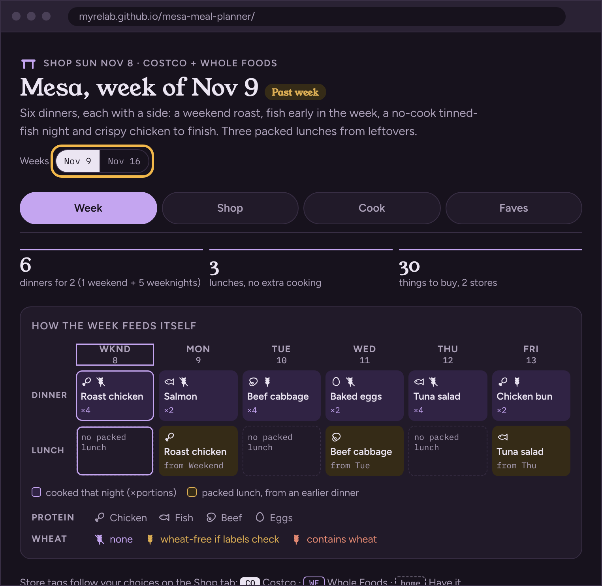
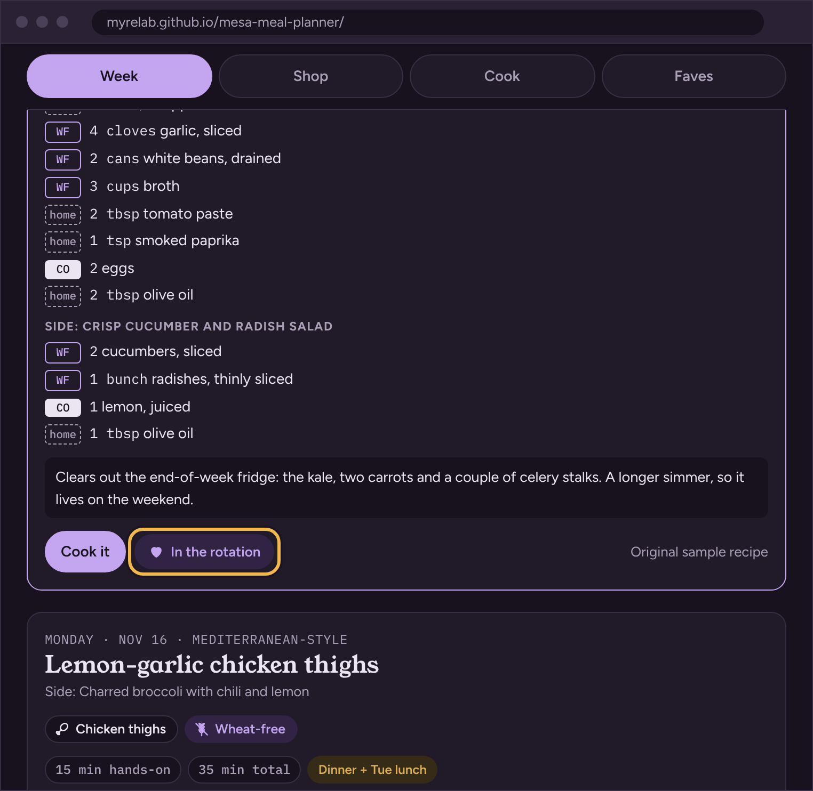
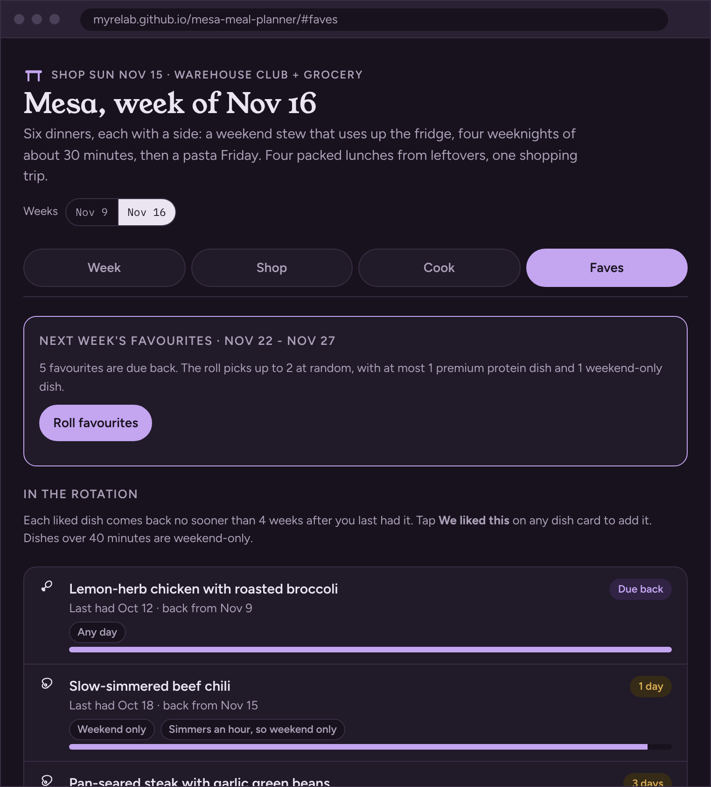
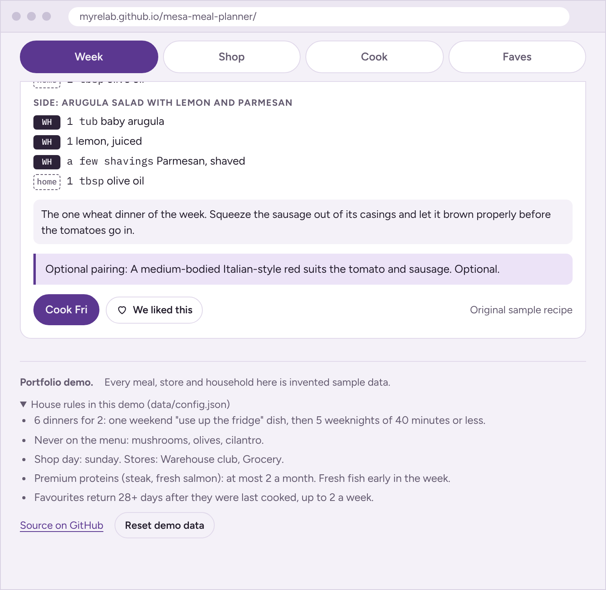
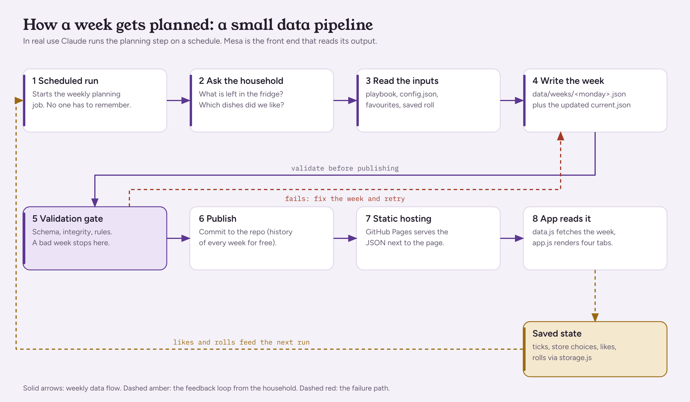
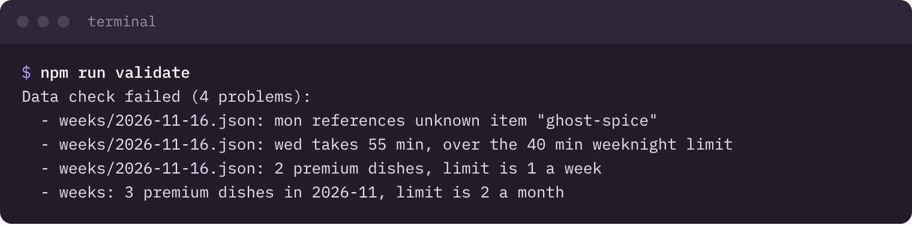
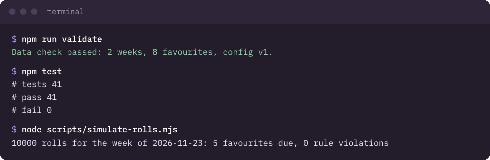

# Mesa

## What it is

**A weekly meal planner that gives me six dinners, one shopping list and packed lunches from the leftovers.**

Try the [Live demo](https://myrelab.github.io/mesa-meal-planner/)

[](https://github.com/MyreLab/mesa-meal-planner/actions/workflows/ci.yml)


*Mesa* is Portuguese for "table". It is a dashboard made with plain HTML, CSS and JavaScript, with all the data stored in JSON files. It works in a desktop browser and on a phone.

## Why I made it

I wanted one shopping trip a week and dinners that are healthy and varied, with enough leftovers for my packed lunch the next day. I wanted all my ingredients in one shopping list, organised by aisle and preferred grocery store. I also wanted this automated and with no friction, so I don't waste my Sunday on another chore.

## What it does

Mesa has four tabs: Week, Shop, Cook and Faves. Here is every feature.

<table>
<tr>
<td width="50%"><br><b>Week.</b> Six dinners and which one feeds which packed lunch, with protein and wheat icons.</td>
<td width="50%"><br><b>Past weeks.</b> Switch to an earlier week to look back. Ticks are kept per week.</td>
</tr>
<tr>
<td><br><b>Shop.</b> How many things to buy at each store, with quick presets and a Copy list button.</td>
<td><br><b>Switch stores.</b> Move an item to another store and the lists regroup.</td>
</tr>
<tr>
<td><br><b>Tick as you shop.</b> Ticks are remembered in the dashboard</td>
<td><br><b>Hide ticked items</b> to see only what is left.</td>
</tr>
<tr>
<td><br><b>Cook.</b> Pick a day to see its recipe, a side dish and what is packed for lunch.</td>
<td><br><b>We liked this.</b> Add a dish to the favourites rotation from its card.</td>
</tr>
<tr>
<td><br><b>Faves.</b> Which favourites are due back, and when each can return.</td>
<td><br><b>Roll favourites.</b> Picks next week's repeats at random, within the rules.</td>
</tr>
<tr>
<td colspan="2"><br><b>House rules.</b> The rules that drive the plan come from one data file, shown at the bottom of the page.</td>
</tr>
</table>

## The data side

How a week gets planned: Claude Code runs the planning step on a schedule. Mesa is the front end that reads its output.



- **The data lives in JSON files** in [`data/`](data): the rules (stores, cook time, budget), the favourites, and one file per week. Here is one day of a week file:

  

- **Each week is checked before it is published.** [`scripts/validate-data.mjs`](scripts/validate-data.mjs) catches mistakes such as an ingredient that is not on the shopping list, a weeknight dinner that takes too long, or too many premium proteins in a week. Run it with `npm run validate`. Here it is on a week I broke on purpose:

  

- **The weekly plan is written by Claude Code** from a written set of rules ([`docs/PLAYBOOK.md`](docs/PLAYBOOK.md)). I do not take the output on trust, which is why the check script exists.
- **The favourites roll is a small function** ([`js/randomizer.js`](js/randomizer.js)) with rules: a dish has to rest for 28 days before it can come back, and a roll gives at most two picks. It has tests, including one that runs thousands of random rolls to check that no rule is ever broken:

  

- **Nothing is stored twice.** The days that use a shopping item are worked out from the recipes, so the list and the recipes cannot disagree.

## Run it yourself

```bash
git clone https://github.com/MyreLab/mesa-meal-planner.git
cd mesa-meal-planner
python3 -m http.server
# open http://localhost:8000
```

Checks need Node 20 or newer:

```bash
npm install         # once
npm test            # tests
npm run validate    # checks the data files
```

## What is in the folders

```
index.html, css/, js/   the website
data/                   sample rules, favourites and weeks (JSON)
schemas/                the expected shape of each data file
scripts/                the data check and the image generators
tests/                  tests
docs/                   playbook, diagram and screenshots
```

## Credits and license

Built by [@MyreLab](https://github.com/MyreLab). Released under the [MIT license](LICENSE).
