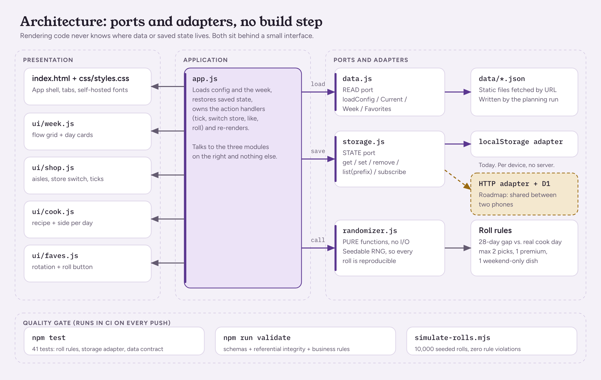
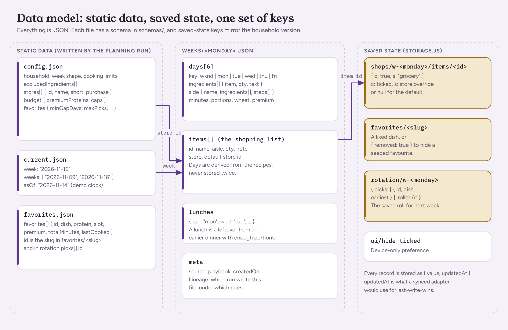
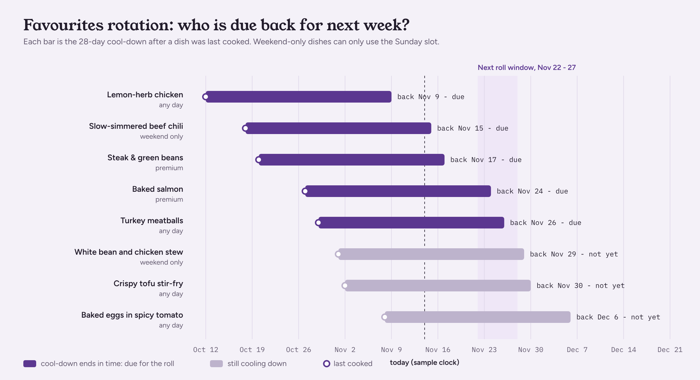
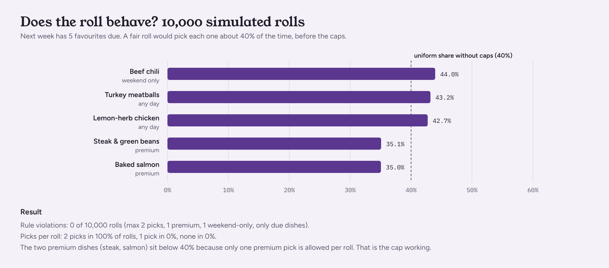
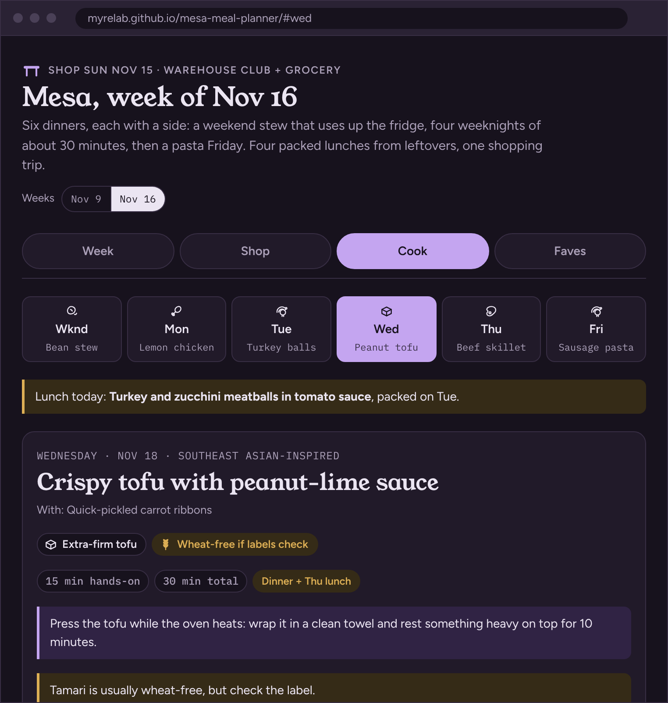

# Mesa

**A weekly meal planner built like a small data product: six dinners, one shopping trip, packed lunches from leftovers.**

[**Live demo**](https://myrelab.github.io/mesa-meal-planner/) (no login, runs on invented sample data) | [Roadmap](docs/ROADMAP.md) | [Planning playbook](docs/PLAYBOOK.md)


*Mesa* is Portuguese and Spanish for "table". It is plain HTML, CSS and vanilla JavaScript with all data in JSON. There is no framework, no build step and no backend.

<p align="center"></p>

## The problem

A busy household wants one shopping trip a week and healthy, varied dinners, without planning from scratch every Sunday. That sounds like a recipe app, but the hard part is data: rules about cook time, budget and what is already in the fridge have to be applied the same way every week, and the output has to be trustworthy enough to shop from.

Mesa is the front end for that. The interesting part is how the data gets there and how it is kept correct.

## Data engineering at a glance

| Concern | How Mesa handles it | Where |
| --- | --- | --- |
| **Data contracts** | Every JSON file has a JSON Schema | [`schemas/`](schemas) |
| **Quality gate** | Structure, referential integrity and business rules are checked before anything ships | [`scripts/validate-data.mjs`](scripts/validate-data.mjs) |
| **Separation of data and code** | One module reads data, one module owns saved state, rendering knows neither | [`js/data.js`](js/data.js), [`js/storage.js`](js/storage.js) |
| **Ports and adapters** | Storage is an interface. localStorage today, an HTTP and D1 adapter on the roadmap | [`js/storage.js`](js/storage.js) |
| **Pure, testable business logic** | The favourites roll has no I/O and takes a seedable random generator | [`js/randomizer.js`](js/randomizer.js) |
| **Rules as data** | Excluded ingredients, stores, cook-time limits and caps live in config | [`data/config.json`](data/config.json) |
| **Normalised model** | A shopping item is stored once. Which days use it is derived from the recipes | [`data/weeks/`](data/weeks) |
| **Key design for migration** | Saved-state keys are path-like, versioned and carry `updatedAt` for last-write-wins | [`js/storage.js`](js/storage.js) |
| **Lineage** | Each week records its source, the playbook it followed and when it was created | `meta` in each week file |
| **Testing** | 41 unit tests, negative tests for the validator, and a 10,000-roll simulation | [`tests/`](tests), [`scripts/simulate-rolls.mjs`](scripts/simulate-rolls.mjs) |
| **CI** | Validation, tests and simulation run on every push | [`.github/workflows/ci.yml`](.github/workflows/ci.yml) |

## Architecture



Two design rules carry most of the weight:

1. **All reads of week, config and favourites data go through `js/data.js`.** Today it fetches static JSON. Later it can call an API, and nothing else changes.
2. **All saved state goes through `js/storage.js`**, which exposes `get`, `set`, `remove`, `list(prefix)` and `subscribe`. Every method is async, so a network adapter drops in without touching the views. The localStorage adapter is one file-sized implementation of that interface, and a memory adapter is used for tests and for browsers where storage is blocked.

```js
// js/storage.js: the whole contract the rest of the app depends on
const storage = createStorage(adapter);       // localStorage today
await storage.set("shops/w-2026-11-16/items/garlic", { c: true, s: null });
await storage.list("shops/w-2026-11-16/items/"); // [{ key, value, updatedAt }]
```

## Data model



Static files are written by the planning run and are read-only for the app. Saved state is written by the app and is keyed so it lines up with the static data:

| Key | Value |
| --- | --- |
| `shops/w-<Monday>/items/<itemId>` | `{ c, s }`: ticked, and the store the user switched to (or `null`) |
| `favorites/<slug>` | a liked dish, or `{ removed: true }` to hide a seeded favourite |
| `rotation/w-<Monday>` | `{ picks, rolledAt, week }`: the saved favourites roll |

## How it is planned each week


In real use Claude runs on a weekly schedule. It asks what is left in the fridge and which dishes were liked, then writes the next week's JSON by following a written playbook of rules ([`docs/PLAYBOOK.md`](docs/PLAYBOOK.md) is a generic version of it). The file then has to pass the validation gate before it is published, and the household's ticks, likes and rolls flow back in as inputs for the next run.

Mesa itself is the front end. This repo ships invented sample data so anyone can open it and try it.

The part worth noting for data work: the assistant is treated as an untrusted producer. It is good at assembling a plausible week, but plausible is not correct, so the contract and the business rules are enforced by code, not by trusting the output.

## Data contracts and quality gate

`npm run validate` runs three layers over `data/` and fails the build on any problem.

| Layer | Checks |
| --- | --- |
| **Structure** | Every file matches its schema: types, required fields, patterns, no unknown fields |
| **Referential integrity** | Every ingredient points at a shopping item. Every item is used by a dish. Store ids exist. Every dish has a side with ingredients and steps, so the side lands on the shopping list. Week files match `current.json` and their file names |
| **Business rules (from `config.json`)** | Weeknight cook time within the limit. At most one weeknight with wheat. At most one premium protein a week and a monthly cap. Fresh fish early in the week. No excluded ingredient anywhere in a recipe. Fridge items only used by the weekend dish. Packed lunches only from an earlier dinner with enough portions |

The validator has its own tests that feed it deliberately broken weeks (a ghost ingredient, a 55-minute weeknight, a second premium dish, a lunch from a later day) and check each one is caught. The schema checker is a small zero-dependency module in [`scripts/lib/schema.mjs`](scripts/lib/schema.mjs), so the whole repo still has no `npm install` step.

## The favourites roll

The Faves tab picks dishes from the rotation that are due back. The rules are pure functions in [`js/randomizer.js`](js/randomizer.js):

- A favourite is due again **28 or more days after it was last cooked**, checked against the actual day it would be cooked. A weekend-only dish can only use the Sunday slot, so it can be "not due" even when a weekday dish with the same date would be.
- **Up to 2 picks a week**, at random from those due, with **at most 1 premium** protein.
- Dishes over **40 minutes are weekend-only**, and a roll takes at most one of them because there is one weekend dinner.
- Each pick gets an `earliest` date when it is only allowed later in the week.
- **Roll favourites** saves the roll for that week. **We liked this** adds a dish to the rotation.



To check the roll is fair and never breaks a rule, `node scripts/simulate-rolls.mjs` runs 10,000 seeded rolls. The chart below is that output: premium dishes are picked less often than the others because only one premium pick is allowed per roll. That is the cap working, not a bias.



## The four tabs

| Week | Shop | Cook | Faves |
| --- | --- | --- | --- |
|  |  |  |  |

- **Week**: a 6-day grid. Day 1 is a weekend "use up the fridge" dish, then five weeknight dinners. Day cards show protein icons and a wheat badge, and a leftover-lunch grid shows which dinner feeds which lunch.
- **Shop**: a checklist grouped by aisle. Each item has a Warehouse club / Grocery / Have it switch. Ticks and store choices survive a reload.
- **Cook**: one recipe card per day, each with a side dish and its method.
- **Faves**: the rotation, the **Roll favourites** randomizer and the **We liked this** button on dish cards.

The weeks selector at the top switches between the two sample weeks, to show how history works. Ticks are kept per week.

## Design decisions

- **No build step.** The repo is the site. ES modules load straight in the browser, GitHub Pages serves the folder, and a cold clone runs with `python3 -m http.server`.
- **Data separated from code.** Meals, stores and rules are JSON. Changing the household means editing `data/config.json`, not code.
- **A storage adapter instead of direct `localStorage` calls.** It makes the later move to a shared database a second adapter rather than a rewrite, and it makes the app testable without a browser.
- **Derived, not duplicated.** Which days use a shopping item is computed from the recipes, so the list and the recipes cannot disagree.
- **Mobile-first.** One narrow column, a sticky tab bar, large tap targets, phone-sized screenshots. It also follows the system dark mode.
- **No third-party requests.** Fonts are self-hosted (SIL Open Font License) and the icons are original SVG, so loading the page contacts no one but the host.
- **Accessibility basics.** Real checkboxes behind the ticks, labelled toggles, a visible focus outline and labelled icons. This is not a full audit.

## Sample data

Everything in `data/` is invented. The sample household is a generic two-person home with neutral rules (it never cooks with mushrooms, olives or cilantro, shops on Sunday, and cooks six dinners). All recipes are written fresh as short, generic home-cooking methods. There are no photographs; the visuals are CSS and original SVG icons.

## Roadmap

A short summary; the full plan is in [`docs/ROADMAP.md`](docs/ROADMAP.md).

- Split the repos: this public engine with sample data, plus a separate private repo for a real household.
- Host on Cloudflare Workers with static assets, adding small `/api/*` routes.
- Share state between phones with Cloudflare D1, as a second `storage.js` adapter.
- Put Cloudflare Access (email one-time PIN) in front of the whole site and API.
- Have the scheduled planning run write weeks through the API or commit them to the private repo.

## Running locally

```bash
git clone https://github.com/MyreLab/mesa-meal-planner.git
cd mesa-meal-planner
python3 -m http.server
# open http://localhost:8000
```

Checks (Node 20 or newer, no dependencies to install):

```bash
npm test                          # unit tests
npm run validate                  # data contracts and business rules
node scripts/simulate-rolls.mjs   # 10,000 seeded favourites rolls
```

The images in this README are generated, so they stay in step with the data:

```bash
python3 scripts/media/diagrams.py   # diagrams and charts
python3 scripts/media/capture.py    # phone screenshots, GIF, hero (needs the server above)
```

Both need `pip install playwright pillow`.

## Repository layout

```
index.html              shell and four tabs
css/styles.css          mobile-first styles, light and dark
js/app.js               loads config and the current week, renders the tabs
js/data.js              the only place that knows where data comes from
js/storage.js           saved state behind get / set / remove / list / subscribe
js/randomizer.js        favourites roll rules, pure functions
js/ui/                  views: week, shop, cook, faves, icons
data/                   config, current pointer, weeks/, favorites (sample data)
schemas/                JSON Schemas for every data file
scripts/                validator, roll simulation, image generators
tests/                  node:test suites, no dependencies
docs/                   roadmap, planning playbook, diagrams, screenshots
```

## Credits and license

Built by [@MyreLab](https://github.com/MyreLab). Released under the [MIT license](LICENSE).

Fonts: Figtree, Young Serif and IBM Plex Mono, all under the SIL Open Font License 1.1 (see [`assets/fonts/README.md`](assets/fonts/README.md)).
