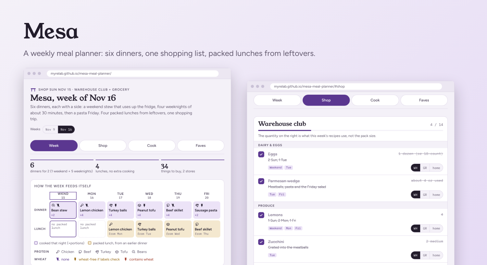
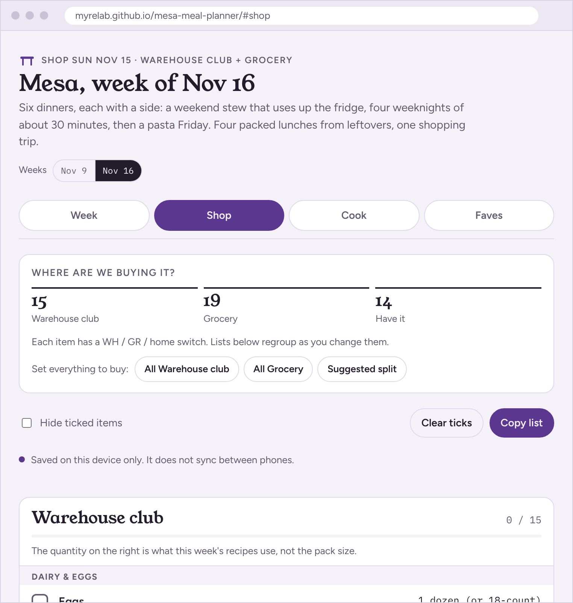
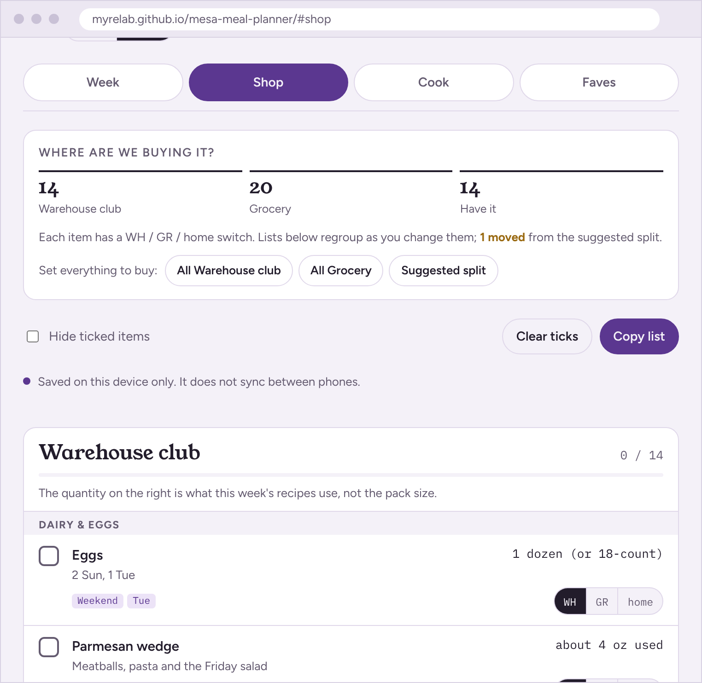
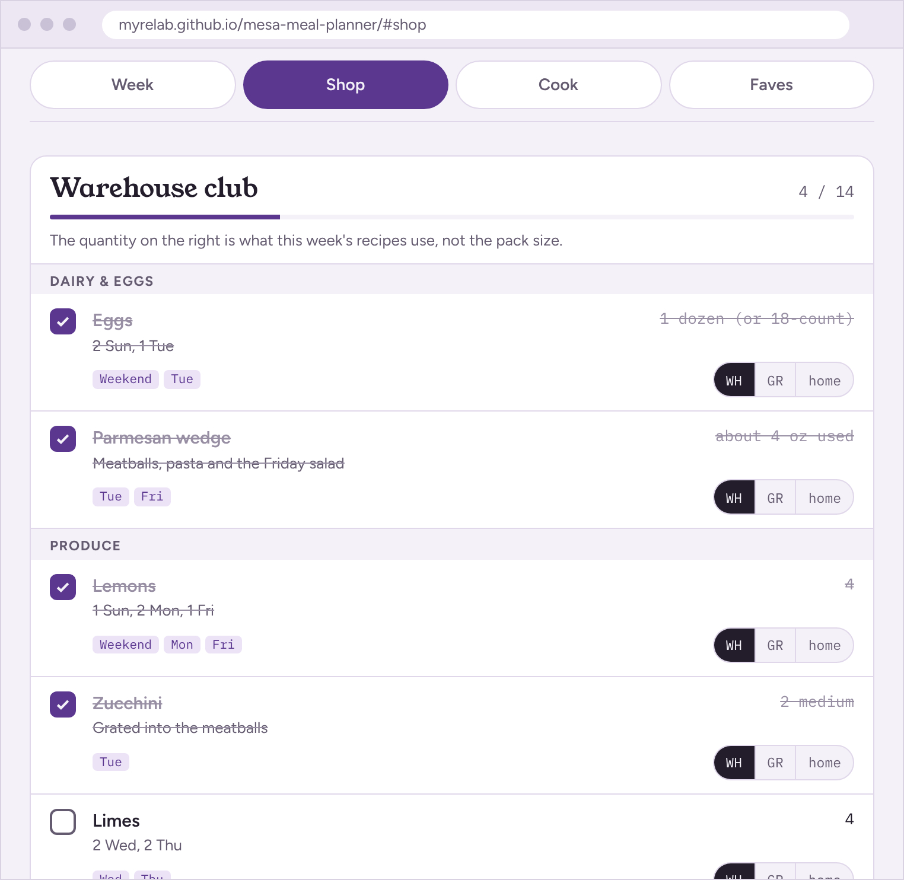
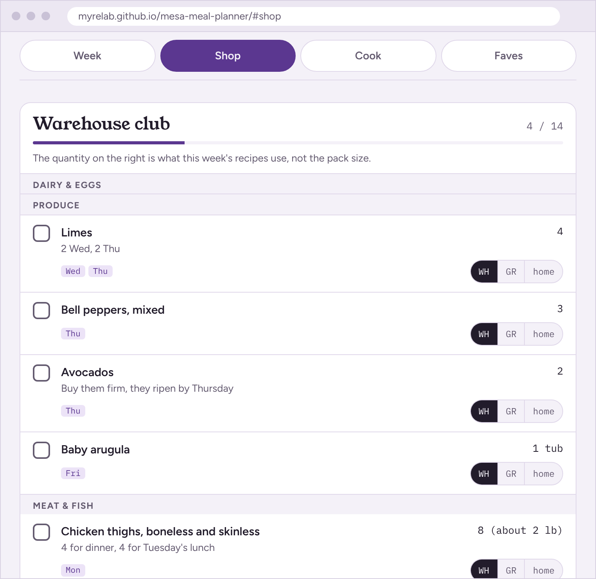
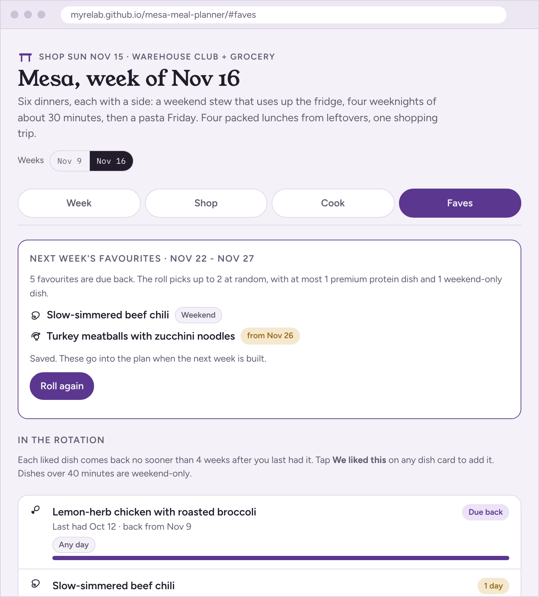
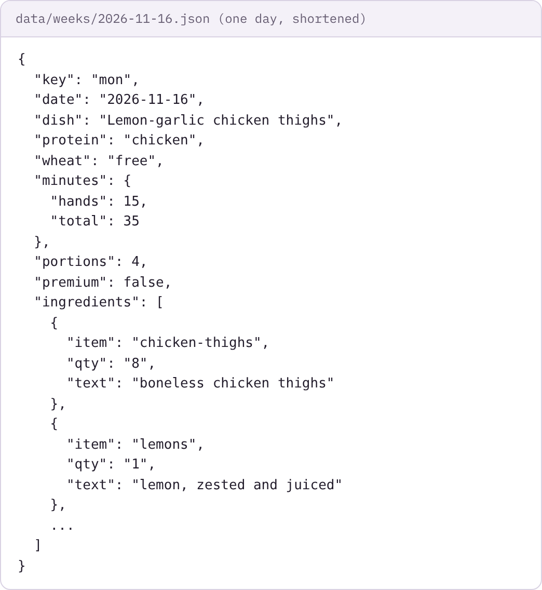

# Mesa

**A personal project: a weekly meal planner that gives me six dinners, one shopping list and packed lunches from the leftovers.**

[**Live demo**](https://myrelab.github.io/mesa-meal-planner/) (no login, runs on invented sample data) | [Planning playbook](docs/PLAYBOOK.md) | [Ideas for later](docs/ROADMAP.md)



*Mesa* is Portuguese and Spanish for "table". It is a small website made with plain HTML, CSS and JavaScript, with all the data stored in JSON files. It works in a desktop browser and on a phone.

<p align="center"></p>

## Why I made it

I wanted one shopping trip a week and dinners that are healthy and varied, without planning from scratch every Sunday. Planning a week is mostly a data problem: cook time, budget and what is already in the fridge all have rules, and the plan has to be right before I shop from it.

## What it does

Mesa has four tabs: Week, Shop, Cook and Faves. Here is every feature, in the browser.

<table>
<tr>
<td width="50%"><br><b>Week.</b> Six dinners and which one feeds which packed lunch, with protein and wheat icons.</td>
<td width="50%"><br><b>Weeks.</b> Switch to an earlier week to look back. Ticks are kept per week.</td>
</tr>
<tr>
<td><br><b>Shop.</b> How many things to buy at each store, with quick presets and a Copy list button.</td>
<td><br><b>Switch stores.</b> Move an item to another store and the lists regroup.</td>
</tr>
<tr>
<td><br><b>Tick as you shop.</b> Ticks are remembered in the browser.</td>
<td><br><b>Hide ticked items</b> to see only what is left.</td>
</tr>
<tr>
<td><br><b>Cook.</b> Pick a day to see its recipe, a side dish and what is packed for lunch.</td>
<td><br><b>We liked this.</b> Add a dish to the favourites rotation from its card.</td>
</tr>
<tr>
<td><br><b>Faves.</b> Which favourites are due back, and when each can return.</td>
<td><br><b>Roll favourites.</b> Picks next week's repeats at random, within the rules.</td>
</tr>
<tr>
<td colspan="2"><br><b>House rules.</b> The rules that drive the plan come from one data file, shown at the bottom of the page.</td>
</tr>
</table>

## The data side

This is the part I care about most.


- **The data lives in JSON files** in [`data/`](data): the rules (stores, cook time, budget), the favourites, and one file per week. Here is one day of a week file:

  

- **Each week is checked before it is published.** [`scripts/validate-data.mjs`](scripts/validate-data.mjs) catches mistakes such as an ingredient that is not on the shopping list, a weeknight dinner that takes too long, or too many premium proteins in a week. Run it with `npm run validate`. Here it is on a week I broke on purpose:

  

- **The weekly plan is written by Claude** from a written set of rules ([`docs/PLAYBOOK.md`](docs/PLAYBOOK.md)). I do not take the output on trust, which is why the check script exists.
- **The favourites roll is a small function** ([`js/randomizer.js`](js/randomizer.js)) with rules: a dish has to rest for 28 days before it can come back, and a roll gives at most two picks. It has tests, and [`scripts/simulate-rolls.mjs`](scripts/simulate-rolls.mjs) runs 10,000 rolls to confirm no rule is ever broken:

  

- **Nothing is stored twice.** The days that use a shopping item are worked out from the recipes, so the list and the recipes cannot disagree.

## Sample data

Everything in `data/` is invented. The sample household is generic, the recipes are short methods written for this project, and there are no photographs.

## Run it yourself

```bash
git clone https://github.com/MyreLab/mesa-meal-planner.git
cd mesa-meal-planner
python3 -m http.server
# open http://localhost:8000
```

Checks need Node 20 or newer and nothing else to install:

```bash
npm test            # tests
npm run validate    # checks the data files
```

## What is in the folders

```
index.html, css/, js/   the website
data/                   sample rules, favourites and weeks (JSON)
schemas/                the expected shape of each data file
scripts/                the data check and the roll simulation
tests/                  tests
docs/                   playbook, ideas, diagrams and screenshots
```

## Credits and license

Built by [@MyreLab](https://github.com/MyreLab). Released under the [MIT license](LICENSE).

Fonts: Figtree, Young Serif and IBM Plex Mono, all under the SIL Open Font License 1.1 (see [`assets/fonts/README.md`](assets/fonts/README.md)).
